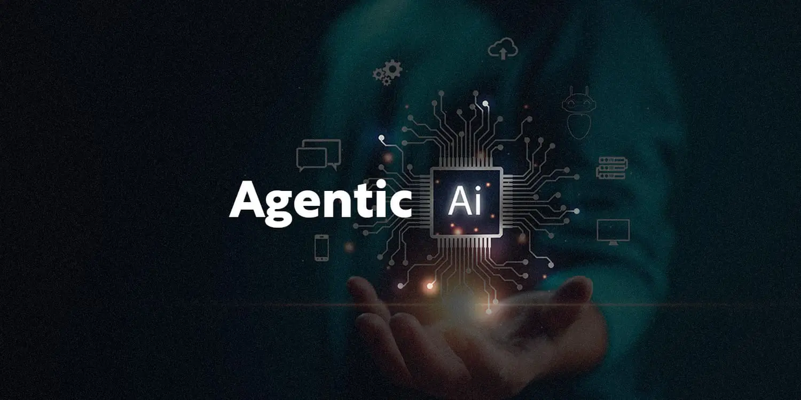

<div align="center">

# Complete Agentic AI with LangChain and LangGraph

**A practical, notebook-first learning repository for Python, LLM applications, AI agents, and graph-based workflows.**

[](https://www.python.org/)
[](https://jupyter.org/)
[](https://www.langchain.com/)
[](https://www.langchain.com/langgraph)
[](https://docs.pydantic.dev/)
[](https://streamlit.io/)
[](https://flask.palletsprojects.com/)
[](https://fastapi.tiangolo.com/)
[](https://platform.openai.com/)
[](https://groq.com/)
[](https://ollama.com/)
[](https://huggingface.co/)
[](https://www.trychroma.com/)
[](https://github.com/facebookresearch/faiss)
[](https://www.langchain.com/langsmith)
[](https://numpy.org/)
[](https://pandas.pydata.org/)
[](https://matplotlib.org/)
[](https://seaborn.pydata.org/)



</div>

## About

I built this repository as a learning path from Python foundations to LLM-powered applications and agentic workflows. Most lessons are Jupyter notebooks; the repository also includes runnable Python, Flask, Streamlit, and FastAPI examples.

I have studied Python fundamentals and data handling, then applied them to LangChain, LangGraph, tool use, human review, and retrieval-augmented generation (RAG). The examples in this repository explore providers and integrations including OpenAI, Groq, Ollama, Hugging Face, Wikipedia, Arxiv, Tavily, Chroma, and FAISS. I organized the course folders in learning order so I can follow them from the beginning or revisit a topic directly.

> **Learning resource:** These examples are intended for experimentation and study. Review each notebook's imports, model settings, credentials, and external-service requirements before running it. Provider APIs and library interfaces can change over time.

## Table of Contents

- [Learning Path](#learning-path)
- [Repository Contents](#repository-contents)
- [Technology and Integrations](#technology-and-integrations)
- [Getting Started](#getting-started)
- [Credentials and Environment Variables](#credentials-and-environment-variables)
- [Running the Examples](#running-the-examples)
- [Example Projects](#example-projects)
- [Contributing](#contributing)
- [Author and Contact](#author-and-contact)
- [License](#license)

## Learning Path

I numbered the course folders consecutively to match the progression through the material:

1. **Python prerequisites** — syntax, variables, data types, control flow, collections, functions, modules, files, exceptions, object-oriented programming, iterators, generators, decorators, data analysis, databases, logging, Flask, Streamlit, memory, and concurrency.
2. **Pydantic** — models, optional and nested fields, and field constraints.
3. **LangChain hands-on** — chat models, prompts, output parsers, document loading and splitting, embeddings, and vector stores.
4. **LLM applications with LCEL** — prompt/model/parser chains and serving a chain as an API.
5. **Conversation history** — chatbot prompts and persistent message history.
6. **Getting started with LangGraph** — graph state, nodes, edges, and chatbot workflows.
7. **LangGraph components** — messages, reducers, tools, ReAct-style agents, memory, and streaming.
8. **Debugging with LangSmith** — tracing and debugging graph workflows.
9. **LangGraph workflow patterns** — prompt chaining, parallelization, routing, orchestrator/worker, and evaluator/optimizer patterns.
10. **Human in the loop** — adding human review to a graph workflow.
11. **RAG with LangGraph** — agentic, corrective, and adaptive retrieval-augmented generation.

## Repository Contents

| Folder | What I cover |
| --- | --- |
| `01. Python Prerequisites/` | Python basics, core language concepts, data analysis, SQLite, logging, Flask, Streamlit, memory management, and threading/multiprocessing examples. |
| `02. Getting Started With Pydantic In Python/` | Notebook examples for Pydantic models and validation. |
| `03. Langchain Hands On/` | OpenAI and Ollama demos, document ingestion and transformation, embeddings, and FAISS/Chroma vector stores. |
| `04. Building Basic LLM Application Using LCEL/` | An LCEL notebook, a FastAPI/LangServe example, a Streamlit client, and a local `requirements.txt`. |
| `05. Building AI agents With Conversation History Using Langchain/` | A chatbot notebook covering prompt templates and conversation history. |
| `06. Getting Started With LangGraph/` | Starter graph and chatbot notebooks, including response streaming. |
| `07. LangGraph Components/` | State schemas, message handling, tools, ReAct-style agents, memory, and streaming. |
| `08. Debugging LangGraph Application With LangSmith/` | An agent example and LangGraph configuration for tracing and debugging workflows. |
| `09. Different Workflows In LangGraph/` | Prompt chaining, parallelization, routing, orchestrator/worker, and evaluator/optimizer workflow notebooks. |
| `10. Human In The Loop In LangGraph/` | Human-in-the-loop graph example. |
| `11. RAG  With LangGraph/` | Agentic, corrective, and adaptive RAG notebooks. |
| `banner.png` | Repository banner displayed near the top of this README. |

## Technology and Integrations

The repository uses the following tools across its lessons and examples. Individual notebooks require only a subset.

- **Language and learning environment:** Python, Jupyter Notebook, IPython.
- **LLM application frameworks:** LangChain, LangChain Expression Language (LCEL), LangGraph, LangServe.
- **Validation and schemas:** Pydantic, Python dataclasses, and typed state definitions.
- **Model providers and runtimes:** OpenAI, Groq, Ollama, and Hugging Face embedding models.
- **Retrieval and vector search:** document loaders and text splitters, embeddings, Chroma, FAISS, and RAG patterns.
- **Tracing and debugging:** LangSmith/LangChain tracing and LangGraph development configuration.
- **Web and demo applications:** Flask, FastAPI, Streamlit, and Uvicorn.
- **Python data tools:** NumPy, pandas, Matplotlib, Seaborn, and SQLite.
- **Example data/search integrations:** PDF and web loaders, Wikipedia, Arxiv, and Tavily search.

## Getting Started

### 1. Get the repository

```bash
git clone https://github.com/Md-Emon-Hasan/Complete-Agentic-AI-With-LangChain-and-LangGraph.git
cd Complete-Agentic-AI-With-LangChain-and-LangGraph
```

If I already cloned this repository, I can open a terminal at its root and continue below.

### 2. Create and activate a virtual environment

```bash
python -m venv .venv
```

I activate the virtual environment in my shell:

```bash
# Windows PowerShell
.venv\Scripts\Activate.ps1

# macOS or Linux
source .venv/bin/activate
```

### 3. Install the packages for the lesson I want to run

There is no single root-level dependency manifest because I have examples from several topic areas. I can start with the provided list for the LCEL lesson I want to run:

```bash
python -m pip install -r "04. Building Basic LLM Application Using LCEL/requirements.txt"
```

For the Python fundamentals demos, I install only the packages used by the lesson I choose. Depending on the example, these include `numpy`, `pandas`, `matplotlib`, `seaborn`, `flask`, `streamlit`, or `scikit-learn`.

For LangChain and LangGraph notebooks, package needs vary. Common integrations used in my repository include `langchain`, `langchain-community`, `langchain-core`, `langchain-openai`, `langchain-groq`, `langgraph`, `langchain-text-splitters`, `langchain-chroma`, `chromadb`, `faiss-cpu`, `langchain-huggingface`, `sentence-transformers`, `pydantic`, and `python-dotenv`. I install the provider and loader packages required by the notebook I plan to run. When a notebook reports a missing module, I install its corresponding package in the active environment and restart the notebook kernel.

The LCEL `requirements.txt` is a starting point for that section, not a complete environment for every included demo. I may also need `fastapi`, `langserve`, `uvicorn`, and `streamlit` for its server and client examples.

### 4. Start Jupyter

```bash
python -m pip install jupyterlab ipykernel
jupyter lab
```

Open a notebook from its course folder and run its cells in order. Some examples need network access, provider credentials, a local Ollama model, or local data files.

## Credentials and Environment Variables

Several examples call hosted model or search APIs. Keep keys out of notebooks and source control. Create a `.env` file in the directory from which the notebook or application loads environment variables, and provide only the values needed by that example:

```dotenv
OPENAI_API_KEY=your_openai_api_key
GROQ_API_KEY=your_groq_api_key
TAVILY_API_KEY=your_tavily_api_key
LANGCHAIN_API_KEY=your_langsmith_api_key
LANGCHAIN_TRACING_V2=true
LANGCHAIN_PROJECT=your_project_name
```

Not every example needs every variable. Review that notebook's setup cells for the expected name; some files use `LANGSMITH_API_KEY` while others use `LANGCHAIN_API_KEY`. Do not commit a populated `.env` file or paste secrets into notebook outputs.

For Ollama-based examples, install and run Ollama separately, then make sure the model referenced by the example is available locally. Some notebooks use Hugging Face embeddings or other external loaders and may download model weights or retrieve remote documents on first use.

## Running the Examples

- **Notebook:** activate the environment, start Jupyter from the repository root, and open the target `.ipynb` file.
- **Python script:** run the script from its lesson folder when it reads or writes relative paths.
- **Streamlit app:** from the directory containing the app, run `streamlit run app.py` (or the desired script name).
- **FastAPI/LangServe demo:** install that section's dependencies, then start `serve.py` using `python serve.py`; the example serves locally on `127.0.0.1:8000`.
- **Flask example:** enter the relevant Flask lesson folder and run the selected app script with Python.

Some notebooks save vector indexes, logs, databases, or sample outputs in their lesson folders. Avoid running examples against important data, and inspect a notebook's paths and side effects before executing all cells.

## Example Projects

### LCEL translation service

The `04. Building Basic LLM Application Using LCEL/` section demonstrates a prompt-to-model-to-parser chain, exposes it through FastAPI/LangServe, and includes a small Streamlit client. The server example uses a Groq model and expects `GROQ_API_KEY`.

### Conversational chatbot

The LangChain and LangGraph chatbot notebooks show prompt templates, stored message history, state updates, and streaming responses. Provider setup differs between notebooks; check the first setup cells before invoking a model.

### Tool-using graph agent

The LangGraph component notebooks build graphs with model and tool nodes, route tool calls, and explore memory/checkpointing. Tool examples include sources such as Wikipedia, Arxiv, and Tavily.

### Retrieval-augmented generation

The LangChain and LangGraph sections demonstrate loading and splitting documents, creating embeddings, indexing with Chroma or FAISS, retrieving relevant content, and composing RAG workflows. The RAG notebooks cover agentic, corrective, and adaptive approaches.

## Contributing

Improvements and corrections are welcome. Please keep examples focused, document required packages and credentials near the lesson, avoid committing secrets or generated caches, and use clear names for new files. For substantial changes, open an issue or pull request describing the lesson or workflow being added.

## Author and Contact

Connect with **Md. Emon Hasan**:

- **Portfolio:** [emonlabs-ai.hitechparks.com](https://emonlabs-ai.hitechparks.com)
- **GitHub:** [Md-Emon-Hasan](https://github.com/Md-Emon-Hasan)
- **LinkedIn:** [Md Emon Hasan](https://www.linkedin.com/in/md-emon-hasan-695483237/)
- **Hugging Face:** [emonHasan01](https://huggingface.co/emonHasan01)
- **Email:** [emon.mlengineer@gmail.com](mailto:emon.mlengineer@gmail.com)
- **WhatsApp:** [+880 1834-363533](https://wa.me/8801834363533)

## License

No license file is currently present in the repository. Unless a license is added, reuse and redistribution are not granted by this README. Add a `LICENSE` file to make the intended terms clear.
