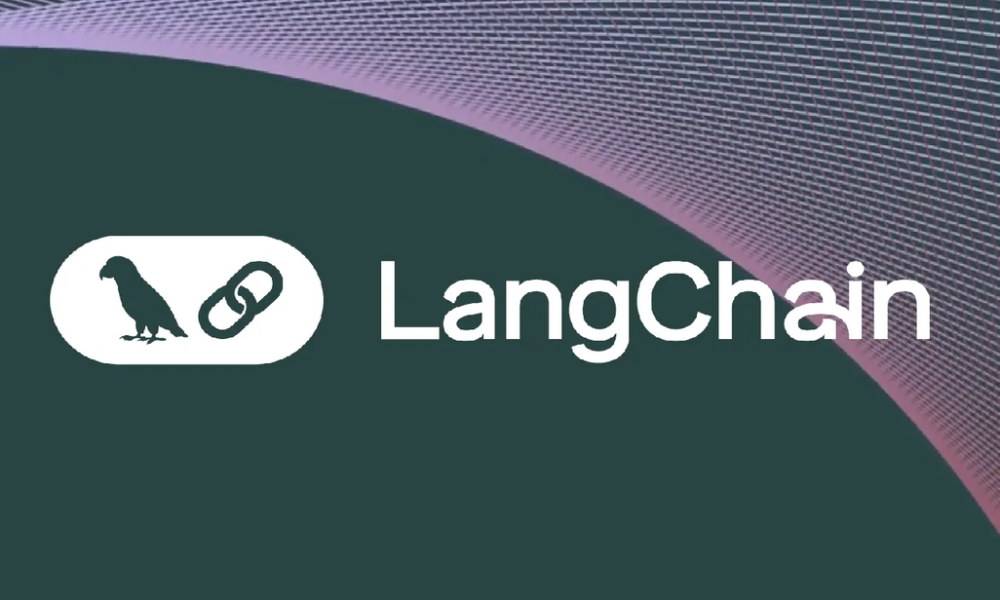

<div align="center">

# Complete LangChain From CampusX

### My hands-on, chapter-by-chapter journey learning LangChain and building LLM applications

[](https://www.python.org/)
[](https://www.langchain.com/)
[](https://jupyter.org/)
[](https://ai.google.dev/)
[](https://huggingface.co/)
[](https://groq.com/)
[](https://streamlit.io/)
[](LICENSE)

<br />



</div>

I am using this repository as a hands-on learning path through core LangChain concepts. I am working through Python examples and Jupyter notebooks, from model calls and prompt design to retrieval-augmented generation (RAG), tools, tool calling, and agents. The examples use hosted model APIs and local embedding models where appropriate.

> **My learning notes:** I organize the code as lesson material, not as one install-and-run application. I work through one chapter at a time and configure the integrations each lesson uses.

## Table of contents

- [What I am learning](#what-i-am-learning)
- [Course roadmap](#course-roadmap)
- [Repository layout](#repository-layout)
- [Getting started](#getting-started)
- [API keys and configuration](#api-keys-and-configuration)
- [Running the examples](#running-the-examples)
- [Notes and troubleshooting](#notes-and-troubleshooting)
- [Contributing](#contributing)
- [License](#license)
- [Connect with me](#connect-with-me)

## What I am learning

- Connect chat models and embedding models through LangChain integrations.
- Build prompts, represent conversation messages, and manage message history.
- Request typed or structured responses and parse model output.
- Compose chains and LangChain Expression Language (LCEL) runnables.
- Load documents from text, PDF, CSV, and web sources, then split them for retrieval.
- Store embeddings, retrieve relevant context, and assemble a RAG workflow.
- Define tools, make model tool calls, and build tool-using agents.

## Course roadmap

I numbered the 15 chapters in this repository sequentially, from 01 to 15.

| Chapter | Topic | What is covered |
| --- | --- | --- |
| 01 | [LangChain Models](01%20LangChain%20Models/) | Google Gemini and Hugging Face chat models; embeddings and document similarity |
| 02 | [Prompts in LangChain](02%20Prompts%20in%20LangChain/) | Prompt templates, messages, chat history, prompt loading, and a small Streamlit prompt UI |
| 03 | [Structured Output](03%20Structured%20Output%20in%20LangChain/) | `TypedDict`, Pydantic, and model structured-output patterns |
| 04 | [Output Parsers](04%20Output%20Parsers%20in%20LangChain/) | String, JSON, structured, and Pydantic output parsers |
| 05 | [Chains](05%20Chains%20in%20LangChain/) | Simple, sequential, parallel, and conditional chains |
| 06 | [Runnables](06%20Runnables%20in%20LangChain/) | Runnable concepts explained through practical notebook examples |
| 07 | [Runnables, Part 2](07%20Runnables%20in%20LangChain%20Part%202/) | Sequence, parallel, passthrough, lambda, and branch runnables |
| 08 | [Document Loaders](08%20Document%20Loaders%20in%20LangChain/) | Load text, PDF, web, and tabular source material |
| 09 | [Text Splitters](09%20Text%20Splitters%20in%20LangChain/) | Length-based, structure-aware, Markdown, code, and semantic splitting |
| 10 | [Vector Stores](10%20Vector%20Stores%20in%20LangChain/) | Store and search vector embeddings |
| 11 | [Retrievers](11%20Retrievers%20in%20LangChain/) | Retriever patterns, including vector-store and Wikipedia-backed retrieval |
| 12 | [Build a RAG System](12%20Building%20a%20RAG%20system%20in%20LangChain/) | Ingestion, splitting, embeddings, vector storage, retrieval, augmentation, and generation |
| 13 | [Tools](13%20Tools%20in%20Langchain/) | Built-in tools and custom tools with tool decorators and classes |
| 14 | [Tool Calling](14%20Tool%20Calling%20in%20LangChain/) | Tool schemas, model tool calls, and handling tool results |
| 15 | [Agents](15%20Agents%20in%20Langchain/) | Agent workflows that choose and use tools |

## Repository layout

```text
.
├── 01 LangChain Models/
│   ├── ChatModels/
│   └── EmbeddingModels/
├── 02 Prompts in LangChain/
├── 03 Structured Output in LangChain/
├── 04 Output Parsers in LangChain/
├── 05 Chains in LangChain/
├── 06 Runnables in LangChain/
├── 07 Runnables in LangChain Part 2/
├── 08 Document Loaders in LangChain/
├── 09 Text Splitters in LangChain/
├── 10 Vector Stores in LangChain/
├── 11 Retrievers in LangChain/
├── 12 Building a RAG system in LangChain/
├── 13 Tools in Langchain/
├── 14 Tool Calling in LangChain/
├── 15 Agents in Langchain/
├── banner.png
├── LICENSE
└── README.md
```

Some lessons include sample PDF, CSV, text, JSON, or image files that are used by the corresponding example. Keep those assets in their lesson folders when running the code.

## Getting started

### Requirements

- Python 3.10 or newer
- Git
- Jupyter Notebook or JupyterLab for notebook lessons
- API credentials for the hosted model integrations used by a lesson

### Clone and prepare an environment

```bash
git clone https://github.com/Md-Emon-Hasan/Complete-LangChain-From-CampusX.git
cd Complete-LangChain-From-CampusX

python -m venv .venv
```

Activate the environment:

```bash
# Windows PowerShell
.venv\Scripts\Activate.ps1

# macOS / Linux
source .venv/bin/activate
```

Install the shared dependencies and start Jupyter:

```bash
python -m pip install --upgrade pip
pip install -r requirements.txt
jupyter lab
```

Then open a chapter notebook, or run a Python example from its chapter directory. A few lessons use optional packages or external services; see [API keys and configuration](#api-keys-and-configuration) and install the relevant integration if a lesson requires it.

## API keys and configuration

Several examples call hosted model APIs. I set credentials for the providers used in the lesson I want to run. A local `.env` file is supported by examples that call `load_dotenv()`:

```dotenv
GOOGLE_API_KEY=your_google_ai_studio_key
GROQ_API_KEY=your_groq_api_key
HUGGINGFACEHUB_API_TOKEN=your_hugging_face_token
```

I create the file in the repository root or in the working directory from which I launch the example. Do not commit real API keys. Some introductory scripts show placeholder values or pass keys directly in code; replace those placeholders with environment-variable reads for local use.

Not every chapter needs every provider. For example, Google Gemini examples need `GOOGLE_API_KEY`, Groq tool-calling/agent examples need `GROQ_API_KEY`, and Hugging Face hosted inference examples need a Hugging Face token. Local embedding examples may download models on first use and need sufficient disk space and memory.

## Running the examples

- **Notebooks:** Open the `.ipynb` file in Jupyter and execute cells in order. Restart the kernel and run cells from the top if state becomes inconsistent.
- **Python scripts:** Run the script from its chapter directory so relative paths to sample data resolve as expected. For example:

  ```bash
  cd "08 Document Loaders in LangChain"
  python pdf_loader.py
  ```

- **Streamlit prompt example:** From the repository root, launch the UI with:

  ```bash
  streamlit run "02 Prompts in LangChain/01 prompt_ui.py"
  ```

Model output, latency, and API availability depend on the selected provider and model. Some examples require network access; local embedding examples may run locally after their model is downloaded.

## Notes and troubleshooting

- LangChain integrations evolve independently. If an import or method in a lesson has changed, check the current documentation for that integration and adapt the individual lesson.
- Some lessons use older LangChain namespaces. LangChain v1 moved several legacy features, including older retriever and hub APIs, to `langchain-classic`; that compatibility package is included in the shared requirements, but a lesson may still need updated imports to match the installed version. See the [LangChain v1 migration guide](https://docs.langchain.com/oss/python/migrate/langchain-v1).
- Vector-store examples may use different backends, including Chroma and FAISS. Install and configure the backend used by the selected notebook.
- Web, search, and YouTube examples depend on third-party services and may change behavior or availability over time.
- Some notebook files retain saved output from earlier runs. Clear outputs in Jupyter before sharing a notebook if the output contains personal or environment-specific information.
- Keep API keys and generated local data out of version control.

## Contributing

Contributions that improve clarity, correct outdated APIs, or add focused examples are welcome. Please keep examples scoped to their chapter, avoid committing credentials or machine-specific notebook output, and describe any provider, package, or setup requirements in the relevant lesson.

## License

This project is released under the [MIT License](LICENSE).

## Connect with me

- **Portfolio:** [emonlabs-ai.hitechparks.com](https://emonlabs-ai.hitechparks.com)
- **GitHub:** [Md-Emon-Hasan](https://github.com/Md-Emon-Hasan)
- **LinkedIn:** [Md Emon Hasan](https://www.linkedin.com/in/md-emon-hasan-695483237/)
- **Hugging Face:** [emonHasan01](https://huggingface.co/emonHasan01)
- **Email:** [emon.mlengineer@gmail.com](mailto:emon.mlengineer@gmail.com)
- **WhatsApp:** [+880 1834-363533](https://wa.me/8801834363533)
