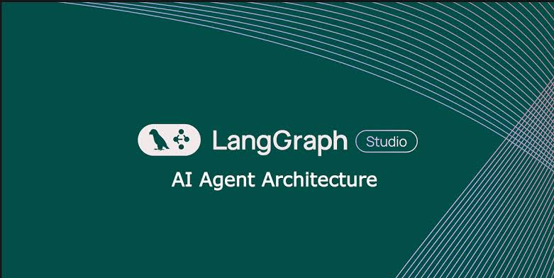

# Complete LangGraph From CampusX

<p align="center">
  <strong>A practical, lesson-by-lesson collection for learning LangGraph workflows and building stateful LLM applications.</strong>
</p>

<p align="center">
  <a href="https://www.python.org/"></a>
  <a href="https://www.langchain.com/langgraph"></a>
  <a href="https://www.langchain.com/"></a>
  <a href="https://streamlit.io/"></a>
  <a href="https://ai.google.dev/gemini-api/docs"></a>
  <a href="https://www.sqlite.org/"></a>
  <a href="https://www.trychroma.com/"></a>
  <a href="https://www.tavily.com/"></a>
  <a href="https://modelcontextprotocol.io/"></a>
  <a href="https://jupyter.org/"></a>
  <a href="LICENSE"></a>
</p>

<p align="center">
  
</p>

## About

This repository follows a hands-on LangGraph learning path, from basic graph workflows to chat applications with persistence, tools, MCP, retrieval-augmented generation (RAG), and human approval. It contains Jupyter notebooks for core concepts and standalone Streamlit examples for interactive applications.

The examples use Google's Gemini models through LangChain integrations. Some lessons also use SQLite checkpoints, Tavily and Wikipedia search, Chroma vector storage, or an MCP server. Each lesson is self-contained; install its dependencies and configure its API keys before running it.

## Learning path

| # | Topic | Materials |
|---:|---|---|
| 1 | Sequential workflows | [Notebooks](<1 - Sequential Workflows in LangGraph/>) — setup, BMI workflow, basic LLM graph, prompt chaining |
| 2 | Parallel workflows | [Notebooks](<2 - Parallel Workflows in LangGraph/>) — parallel batsman analysis and essay workflow |
| 3 | Conditional workflows | [Notebooks](<3 - Conditional Workflows in LangGraph/>) — conditional routing examples |
| 4 | Build a chatbot | [Notebook](<4 - Building a Chatbot with LangGraph/>) |
| 5 | Persistence and time travel | [Notebook](<5 - Persistence in LangGraph/>) |
| 6 | Chatbot UI | [Streamlit app](<6 - Chatbot UI with LangGraph and Streamlit/>) — graph backend and chat interface |
| 7 | Streaming | [Streamlit app](<7 - Streaming with LangGraph/>) — stream generated message chunks |
| 8 | Multi-thread chat | [Streamlit app](<8 - Multi-Thread Chat with LangGraph/>) — create and resume conversations |
| 9 | Database persistence | [Streamlit app](<9 - Chatbot with Database Persistence/>) — store checkpoints in SQLite |
| 10 | Tool-calling agent | [Streamlit app](<10 - Tool-Calling Agent with LangGraph/>) — Tavily and Wikipedia tools |
| 11 | MCP client | [Streamlit app](<11 - MCP Client with LangGraph/>) — connect to Model Context Protocol tools |
| 12 | RAG | [Streamlit app](<12 - RAG with LangGraph/>) — retrieval and tool-assisted responses |
| 13 | Human-in-the-loop | [Notebook and apps](<13 - Human-in-the-Loop with LangGraph/>) — inspect the app before enabling external actions |
| 14 | Hallucination exploration | [Notebook](<14 - Hallucination in LLM/>) |

## Concepts covered

- Graph state, nodes, edges, and conditional routing
- Sequential and parallel execution patterns
- Message state and conversation memory
- Checkpointing, persistence, and conversation threads
- Token streaming in a Streamlit chat interface
- Tool calling and MCP tool integration
- Retrieval-augmented generation with embeddings and a vector store
- Human approval flows for tool execution
- Basic hallucination checks and grounding responses in retrieved information

## Technology stack

- **Language:** Python
- **Orchestration:** LangGraph
- **LLM integration:** LangChain, `langchain-google-genai`, Google Gemini
- **Interactive UI:** Streamlit
- **Persistence:** SQLite and LangGraph checkpointers
- **Retrieval:** Chroma, Google embeddings, and LangChain text splitters
- **Tools:** Tavily Search, Wikipedia, and Model Context Protocol (MCP)
- **Experiments:** Jupyter notebooks

Different lessons use different subsets of the stack. The badges above summarize technologies present in the repository; they do not imply that every example uses every tool.

## Repository layout

```text
.
├── banner.png
├── LICENSE
├── README.md
├── 1 - Sequential Workflows in LangGraph/
├── 2 - Parallel Workflows in LangGraph/
├── 3 - Conditional Workflows in LangGraph/
├── 4 - Building a Chatbot with LangGraph/
├── 5 - Persistence in LangGraph/
├── 6 - Chatbot UI with LangGraph and Streamlit/
├── 7 - Streaming with LangGraph/
├── 8 - Multi-Thread Chat with LangGraph/
├── 9 - Chatbot with Database Persistence/
├── 10 - Tool-Calling Agent with LangGraph/
├── 11 - MCP Client with LangGraph/
├── 12 - RAG with LangGraph/
├── 13 - Human-in-the-Loop with LangGraph/
└── 14 - Hallucination in LLM/
```

Notebooks are stored in the first five and final two lessons. The middle lessons contain Python backends and Streamlit frontends. Some database and vector-store files may be created locally when those examples run.

## Getting started

### 1. Clone the repository

```bash
git clone <repository-url>
cd <repository-directory>
```

Replace the placeholders with the Git URL and directory name shown on the repository's Git hosting page.

### 2. Create and activate a virtual environment

```bash
python -m venv .venv
```

Windows PowerShell:

```powershell
.venv\Scripts\Activate.ps1
```

macOS or Linux:

```bash
source .venv/bin/activate
```

### 3. Install the dependencies for the lesson

There is no root-level dependency lockfile because the examples have different requirements. Install the packages used by the lesson you plan to run. Common packages include:

```bash
python -m pip install langgraph langchain-core langchain-google-genai python-dotenv streamlit
```

Some lessons also need `langchain-community`, `langchain-text-splitters`, `chromadb`, `mcp`, and a Jupyter environment. For example:

```bash
python -m pip install langchain-community langchain-text-splitters chromadb mcp jupyter
```

Install additional packages if a selected lesson reports a missing import. Using a virtual environment keeps lesson dependencies separate from other Python projects.

### 4. Configure API keys

Several examples call Gemini and load local environment variables with `python-dotenv`. Create a `.env` file in the relevant lesson directory, beside its Python files:

```dotenv
GOOGLE_API_KEY=your_google_ai_studio_api_key
TAVILY_API_KEY=your_tavily_api_key
```

`TAVILY_API_KEY` is needed only for lessons that enable Tavily search. Do not commit `.env` files or paste API keys into notebooks. Some notebook examples may require setting credentials in the notebook kernel's environment before running cells.

### 5. Run a lesson

Open a notebook from its lesson folder in Jupyter, or start a Streamlit example from that folder. For example, in PowerShell:

```powershell
Set-Location "6 - Chatbot UI with LangGraph and Streamlit"
streamlit run streamlit_frontend.py
```

For the later Streamlit lessons, start the frontend script found in that lesson folder. Run the command from the same folder so local backend imports, `.env`, and generated databases resolve as expected. The Human-in-the-Loop lesson includes `app.py` and `main.py`; choose the example you want to explore.

## Lesson-specific notes

- **API access:** Gemini-backed examples need a valid Google AI Studio API key and network access. Model identifiers can change over time; update the model configured in a lesson if your provider no longer supports it.
- **Search tools:** Tool-agent and RAG examples may call Tavily and Wikipedia. Configure the matching API key where required.
- **MCP:** The MCP lesson includes an example server configuration. Review and configure its server command for your environment before expecting external MCP tools to connect.
- **Persistence:** SQLite checkpoint databases are created or updated by some demos. Keep them if you want to retain local conversation state.
- **RAG:** The RAG demo may create or use a local Chroma collection. Its documents, embeddings, and API-backed generation require the relevant local files, packages, credentials, and model access.
- **Human approval:** Read the tool definitions in the HITL example before enabling actions. The included demonstration tools illustrate an approval flow; they should not be treated as connected production services.

## Troubleshooting

- **Missing module:** Activate the virtual environment and install the missing package in that environment.
- **Authentication or quota error:** Confirm the relevant API key is set in the process environment or the lesson's `.env` file, and check provider access and quota.
- **Backend import error:** Run Streamlit from within the lesson directory so its local Python modules are on the import path.
- **MCP connection unavailable:** Check that the configured MCP server command and its runtime are installed and available to the process.
- **Unexpected old conversation state:** Start a new chat or inspect the lesson's SQLite database and checkpoint configuration.

## Contributing

Contributions that improve lesson explanations, correct outdated APIs, clarify setup, or add focused LangGraph examples are welcome. Keep each lesson self-contained where practical, document any external services or credentials it needs, and avoid committing secrets or generated environment-specific data.

## Author

**Md. Hasan Imon** — Machine Learning Engineer

Areas of interest include AI, machine learning, generative AI, AI agents, multi-agent systems, LangGraph, and AgentOps.

## Connect

- **Portfolio:** [emonlabs-ai.hitechparks.com](https://emonlabs-ai.hitechparks.com)
- **GitHub:** [Md-Emon-Hasan](https://github.com/Md-Emon-Hasan)
- **LinkedIn:** [Md Emon Hasan](https://www.linkedin.com/in/md-emon-hasan-695483237/)
- **Hugging Face:** [emonHasan01](https://huggingface.co/emonHasan01)
- **Email:** [emon.mlengineer@gmail.com](mailto:emon.mlengineer@gmail.com)
- **WhatsApp:** [+880 1834-363533](https://wa.me/8801834363533)

## License

This project is distributed under the [MIT License](LICENSE).
